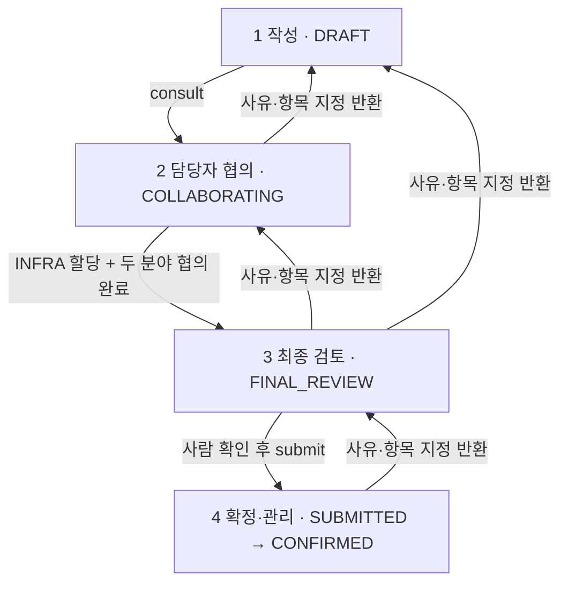

# API·업무 계약

기준: 2026-11-06 구현, FUNCTIONAL_SPEC v1.2. 아래는 현재 코드의 계약이며 기관의 최종 업무 양식을 확정한 문서가 아닙니다. 잠정 필드·권한 선택은 [ADR 0004](adr/0004-provisional-schema-and-permissions.md)를 참조합니다. 실행 중인 OpenAPI는 `/v3/api-docs`, UI는 `/swagger-ui.html`입니다.

## 공통

- 기본 경로 `/api`, JSON은 camelCase, 성공은 DTO/목록을 직접 반환합니다.
- 인증은 서버 세션입니다. 클라이언트가 보낸 role·기관·사용자 이름을 권한 근거로 사용하지 않습니다.
- `GET /api/auth/csrf`의 `headerName`과 `token`을 읽고 모든 변경 요청에 해당 헤더를 보냅니다. 로그인 뒤 새 CSRF 토큰을 다시 받습니다.
- 변경 요청은 읽어 온 `revision`을 `expectedRevision`에 명시합니다. 누락·음수는 거절합니다. 현재 구현은 `If-Match` 대신 본문 revision을 사용합니다.
- 신청 제출과 정책 게시에는 `Idempotency-Key` 헤더를 보냅니다. 같은 키로 재전송한 성공 요청은 기존 결과를 반환하며 새 제출본을 만들지 않습니다.
- 시간은 ISO 8601, 날짜는 `YYYY-MM-DD`입니다. 서버 저장 시각과 사용자용 Asia/Seoul 표시를 구분합니다.
- 오류는 `application/problem+json`: `type`, `title`, `status`, `detail`, `code`, `requestId`; 충돌 응답은 해당 경우 `latestRevision`을 포함합니다.

| HTTP | 의미·클라이언트 동작 |
|---|---|
| 400 | 요청 형식·필수값 확인 |
| 401 | 세션 만료 또는 미인증, 재로그인 |
| 403 | 역할·CSRF·업무 주체 권한 없음 |
| 404 | 없는 신청 또는 열람 범위 밖 신청; 존재 여부를 노출하지 않음 |
| 409 | 오래된 revision·현재 단계와 맞지 않는 행동; 입력을 보존하고 최신값 비교 |
| 422 | 필드·할당·검토·보완 등 업무 선행 조건 또는 값 검증 실패 |
| 413/415 | 업로드 크기·형식 제한 |
| 429/503 | 호출 제한·일시적인 준비/서비스 오류 |

## 인증

| 메서드·경로 | 입력·응답 |
|---|---|
| `GET /auth/csrf` | CSRF 헤더 이름·토큰 |
| `POST /auth/login` | form-urlencoded `username`, `password`; 로그인 세션 응답 |
| `GET /auth/session` | `user`, `institutionName`, `expiresAt` |
| `POST /auth/extend` | 세션 만료 시각 갱신 |
| `POST /auth/logout` | 세션 폐기, 204 |
| `GET /health` | 기동 상태 |

쿠키는 `SECURITYADVISOR_SESSION`, HttpOnly, SameSite Strict입니다. 기본 설정은 Secure이며 loopback 합성 HTTP 실행에 사용하는 `local` 프로필만 Secure를 끕니다. 로컬 프로필로 외부 운영 서비스를 공개하지 않습니다.

## 신청과 필드

| 메서드·경로 | 허용 주체·계약 |
|---|---|
| `GET /security-requests` | 신청자 본인 또는 공개된 같은 기관의 담당자 범위 |
| `POST /security-requests` | APPLICANT; `title`, `documentType`, `department`, `description`; 201 |
| `GET /security-requests/{id}` | 열람 권한이 있는 신청 전체 DTO |
| `PATCH /security-requests/{id}/answers` | 현재 단계에서 본인 담당 필드만 저장·확인 |
| `PUT /security-requests/{id}/network` | INFRA; `expectedRevision`, `rules` |

`documentType`은 `FIREWALL`, `SECURITY_REVIEW`입니다. 응답은 필드·통신·검토·보완·이력 외에 `stage`, `status`, `revision`, `policyVersion`, `allowedActions`, `blockers`, `allocation`, `finalReviews`, `returnItems`, `submissionVersion`, `finalDraft`를 포함합니다. 화면은 서버가 계산한 허용 행동을 사용하고, 서버는 실제 변경 시 다시 검사합니다.

필드 변경 예:

```json
{
  "expectedRevision": 3,
  "answers": [
    {
      "key": "purpose",
      "value": "공개 안내자료를 찾는 합성 서비스",
      "confirmed": true,
      "notApplicable": false
    }
  ]
}
```

필드마다 `key`, `label`, `reason`, `ownerRole`, `requiredAt`, `value`, `status`, `source`, `confirmation`을 전달합니다. source가 없으면 화면에 **담당자 확인 필요**로 표시합니다. AI 원출처는 사람이 확인해도 보존하며 `confirmation`에 확인 주체·역할·시각을 별도로 기록합니다.

| 의미 | 현재 JSON `source.kind` |
|---|---|
| 사용자 답변 | `USER_ANSWER` |
| AI 추론과 근거 | `AI_INFERRED` |
| 담당자 입력 | `STAFF_INPUT` |
| 담당자 확인 | `STAFF_CONFIRMED` |

원문 용어 `AI_INFERENCE`, `SPECIALIST_INPUT`, `SPECIALIST_CONFIRMATION`는 같은 의미의 이전 입력 이름으로 호환 처리하지만 새 응답의 canonical 이름은 위 표입니다. 임의 출처·담당자 신원을 입력 DTO로 받지 않습니다.

## 4단계·전이



`CLOSED`와 `WITHDRAWN`은 사유를 보존하는 종료 상태입니다. 종료 후 변경 행동을 제공하지 않습니다. 이전 `RECEIVED` 상태는 데이터 호환용이며 현재 응답에서는 `SUBMITTED`로 정규화합니다.

아래 경로는 `/security-requests/{id}` 뒤에 붙습니다. 기본 변경 본문은 `{"expectedRevision": 3}`입니다.

| 메서드·하위 경로 | 주체 | 조건·추가 입력·결과 |
|---|---|---|
| `POST /consult` | APPLICANT | 협의 전 필수 항목의 사람 확인 후 1→2 |
| `POST /allocation` | INFRA | 할당 필수 항목 확인, `comment`; 할당만 완료 |
| `POST /review/start` | 담당 분야 | SECURITY는 INFRA 할당 완료가 선행 |
| `POST /review` | 담당 분야 | 담당 필드·보완 확인, `comment`; 두 분야 완료 후 2→3 |
| `POST /final-draft` | APPLICANT | 3단계 최종 AI 초안, 미확정 결과 |
| `POST /final-draft/{analysisId}/confirm` | APPLICANT | 현재 AI 보완분을 사람이 명시 확인 |
| `POST /submit` | APPLICANT | 미확정·보완·검토 차단 사유 없음, 멱등 키; 3→4, 불변 제출본 생성 |
| `POST /final-review` | INFRA/SECURITY | 4단계 현재 제출본의 분야별 최종 검토, `comment` |
| `POST /confirm` | INFRA/SECURITY | 양 분야 최종 검토 완료 후 `CONFIRMED` |
| `POST /return` | 단계 담당 주체 | `targetStage`, `reason`, `fieldKeys`; 아래 반환 규칙 |
| `POST /close` | INFRA/SECURITY | `reason` 필수, 종결(반려) |
| `POST /withdraw` | 작성자 | `reason` 필수, 철회 |

반환은 2→1과 4→3에서 전문 담당자, 3→1·3→2에서 작성자가 요청합니다. 선택 항목은 중복 없이 실제 존재하는 필드 키여야 하며 방화벽에는 `network`도 사용합니다. 기존 필드·통신 값·제출 이력을 유지하면서 선택·의존 항목의 확인과 필요한 검토만 무효화합니다. 반환으로 이전 차수의 HTML을 수정하지 않습니다.

`POST /receive`는 이전 API의 문서 접수 호환 경로이며 신규 화면은 `/final-review`, `/confirm`을 사용합니다. 접수·최종 검토·서류 확정 중 어느 것도 실제 장비 적용 완료 상태를 생성하지 않습니다.

## 보완·AI·문서

| 메서드·하위 경로 | 계약 |
|---|---|
| `POST /supplements` | 담당 분야가 `question`을 등록, `expectedRevision` 필수 |
| `POST /supplements/{supplementId}/answer` | 작성자가 `answer` 입력, 답변만으로 해소되지 않음 |
| `POST /supplements/{supplementId}/resolve` | 요청 분야 담당자가 답변을 재확인 |
| `POST /analysis` | multipart `expectedRevision`, `text` 또는 `file`; UTF-8 TXT/MD 1MiB |
| `GET /analysis` | 분석 이력, 입력 revision·구성 revision·모드·실패 표시 |
| `POST /analysis/{analysisId}/apply` | 최신 미반영 후보만 신청에 반영; 값은 미확정 |
| `POST /assistant` | 담당자 질문 `question`과 revision; 공개 검색 근거를 사용하는 AI 제안 |
| `GET /document` | 현재 초안 또는 최신 불변 제출본 HTML 첨부 |
| `GET /document?version=1` | 지정된 제출 차수 HTML |
| `GET /submissions` | 보존된 모든 제출 차수 메타데이터 |

AI 작업은 실행 시점 신청 revision·모델 구성 revision을 보관합니다. 오래되었거나 이미 적용된 분석은 `STALE`, 실패는 `FAILED`로 구별합니다. `EXAMPLE`은 합성 모드, `LIVE`는 외부 모델 구성 모드이며 `LIVE`라는 표시만으로 실호출 성공을 주장할 수 없습니다. 3단계 최종 초안도 확인 전 `confirmed=false`입니다.

업로드 원문 속 지시문은 데이터입니다. 내부 IP·시스템명을 AI가 발명하여 확정 필드로 넣지 않습니다. 다운로드 HTML은 자유 입력을 이스케이프하며 React 화면에 임의 HTML을 주입하지 않습니다.

## 기관 설정·지식

| 메서드·경로 | 주체·계약 |
|---|---|
| `GET /institution/settings` | ADMIN; 초안·게시본·revision·이력 |
| `PUT /institution/settings` | ADMIN; `expectedRevision`, `policy` 초안 저장 |
| `POST /institution/settings/publish` | ADMIN; revision+멱등 키, 새 게시 버전 |
| `GET /institution/contexts` | ADMIN; 해당 기관 비공개 컨텍스트 메타데이터 |
| `POST /institution/contexts` | ADMIN; `title`, `category`, `content`, 201; 별도 암호화 보관 |
| `GET /institution/models` | ADMIN; 용도별 모델 구성·revision·변경 이력 |
| `PUT /institution/models` | ADMIN; `expectedRevision`, `connections` |
| `GET /knowledge` | 인증 사용자; 공개 자료 안내 |
| `GET /knowledge/search?q=...` | 인증 사용자; 공개 요약 pgvector 검색 |

1차 협의는 `INFRA_FIRST` 고정입니다. `PARALLEL`·다른 순서의 정책 저장은 거절합니다. 신청은 생성 시점의 게시 정책을 고정하므로 게시가 기존 신청 필드를 바꾸지 않습니다. 모델 실행 구성은 별도 DB에서 관리하고 작업마다 실행 스냅샷을 기록합니다.

모델 `connections`는 각 용도 `DOCUMENT_ANALYSIS`, `STAFF_ASSISTANT`, `FINAL_DRAFT`에 `connection`을 하나씩 둡니다. 공급자는 `EXAMPLE`, `OPENAI`, `OPENAI_COMPATIBLE`; 비밀값은 받지 않고 고정된 환경변수 참조만 받습니다. endpoint는 서버 허용 목록과 HTTPS 호스트 제한을 검사합니다.

공개 검색 응답의 `embeddingMethod=LOCAL_FEATURE_HASH_256`, `fullDocumentsIndexed=false`는 현재 한계를 표현합니다. 현재 색인은 공식 공개 페이지 2종의 짧은 편집 요약입니다. 기관 업로드·비공개 컨텍스트는 공개 벡터 테이블에 넣지 않습니다.

## 잠정 필드·통신 제약

전체 필드표와 권한 가정은 [ADR 0004](adr/0004-provisional-schema-and-permissions.md)에 있습니다. 현재 네트워크 규칙은 IPv4 또는 /24~ /32 CIDR, TCP/UDP/ICMP, `ONE_WAY`/`BIDIRECTIONAL`을 지원합니다. TCP/UDP 포트는 1~65535 안의 단일 값 또는 1024개 이하 범위, ICMP 포트는 비우거나 `-`, 적용 기간의 날짜 차이는 최대 366일입니다. 이는 **프로토타입 검증 제한**이며 기관 보안 규정으로 확정된 값이 아닙니다.
